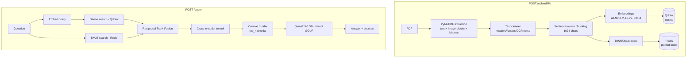

# DocRag — Hybrid RAG Backend for PDF Question Answering

DocRag is a FastAPI backend that lets you **upload a PDF and ask questions about it**. Answers are grounded strictly in the document and returned with their sources (page, chunk, scores).

It combines **dense vector search (Qdrant)** and **keyword search (BM25 cached in Redis)**, fuses them with **Reciprocal Rank Fusion**, refines the results with a **cross-encoder reranker**, and generates the answer with a **local quantized Qwen2.5 GGUF model** — no paid LLM API needed.

---

## Table of Contents

- [Features](#features)
- [Architecture](#architecture)
- [Tech Stack](#tech-stack)
- [Project Structure](#project-structure)
- [How It Works](#how-it-works)
- [API Reference](#api-reference)
- [Configuration](#configuration)
- [Getting Started](#getting-started)
- [Docker & Hugging Face Spaces](#docker--hugging-face-spaces)
- [Evaluation](#evaluation)
- [Known Limitations & Security Notes](#known-limitations--security-notes)
- [Roadmap](#roadmap)

---

## Features

- **PDF ingestion pipeline**: layout-aware extraction (PyMuPDF), cleaning, sentence-aware chunking, embedding.
- **Hybrid retrieval**: Qdrant dense search + BM25 sparse search merged with RRF (k=60).
- **Cross-encoder reranking**: `cross-encoder/ms-marco-MiniLM-L-6-v2` re-scores candidates.
- **Grounded generation**: prompt forces the model to answer only from context, or say the info isn't available.
- **Source attribution**: every answer includes page, chunk, retrieval and rerank scores, and chunk text.
- **Per-document isolation**: all searches are filtered by `document_id`.
- **Spatial metadata**: chunks keep merged bounding boxes, source blocks and sentence ranges (useful for highlighting in a PDF viewer).
- **Evaluation suite**: Recall@K, MRR, and LLM-as-judge scoring, baseline vs. reranked.
- **Deployable** as a Docker image or a Hugging Face Space (Gradio status page at `/ui`).

## Architecture



## Tech Stack

| Layer | Technology |
|---|---|
| API | FastAPI, Uvicorn |
| UI / hosting shim | Gradio (mounted at `/ui`), Hugging Face Spaces (ZeroGPU) |
| PDF parsing | PyMuPDF (`fitz`) |
| Embeddings | `sentence-transformers` — `all-MiniLM-L6-v2` |
| Vector DB | Qdrant (cloud), cosine distance |
| Sparse search | `rank-bm25` (BM25Okapi), cached in Redis |
| Reranker | `cross-encoder/ms-marco-MiniLM-L-6-v2` (CPU) |
| LLM | `Qwen2.5-1.5B-Instruct` Q4_K_M GGUF via `llama-cpp-python` (fallback: `ctransformers`) |
| Config | `python-dotenv` |

## Project Structure

```
backend/
├── app.py                  # Hugging Face Space entrypoint: FastAPI + Gradio (/ui), port 7860
├── Dockerfile              # python:3.12-slim image, runs app.main:app on 7860
├── requirements.txt
├── pi                      # Helper script: pip install into .venv and refresh requirements.txt
├── app/
│   ├── main.py             # Plain FastAPI entrypoint (/, /health, routers)
│   ├── api/routes/
│   │   ├── upload.py       # POST /upload/file
│   │   └── query.py        # POST /query, GET /debug/document/{id}/chunks
│   └── services/
│       ├── pdf_extractor.py        # PyMuPDF page/block/image extraction
│       ├── text_cleaner.py         # Header/footer/page-number/OCR-noise removal
│       ├── chunking_service.py     # Sentence-aware chunking + embedding model
│       ├── pdf_ingestion.py        # Orchestrates the ingestion pipeline
│       ├── qdrant_service.py       # Collection mgmt, upsert, search, fetch by id
│       ├── redis_service.py        # Save/load pickled BM25 index
│       ├── hybrid_search_service.py# Dense + BM25 + RRF
│       ├── retrieval.py            # Dense-only retrieval helper
│       ├── reranking.py            # Cross-encoder reranker
│       ├── context_builder.py      # Formats chunks into the LLM context
│       ├── generation_service.py   # GGUF model loading + prompting
│       └── rag_service.py          # Orchestrates retrieve → rerank → generate
├── tests/                  # Evaluation scripts, question set and results
└── qdrant_storage/         # Local Qdrant storage metadata
```

## How It Works

### 1. Ingestion (`app/services/pdf_ingestion.py`)
1. **Extract** — `pdf_extractor.py` reads each page with PyMuPDF, producing text blocks (with bounding boxes) and saving embedded images to `uploads/images/`.
2. **Clean** — `text_cleaner.py` removes page numbers, blank/OCR-garbage blocks, and repeated headers/footers (short text in the top/bottom 12% of the page that repeats on at least half the pages). It preserves LaTeX, equations, code and captions.
3. **Chunk** — `chunking_service.py` splits blocks into sentences and packs them into chunks of up to **1024 characters** per page. Each chunk keeps `page`, `chunk` number, `start_sentence`/`end_sentence`, merged `bbox` and `source_blocks`.
4. **Embed** — each chunk is encoded with `all-MiniLM-L6-v2` (normalized, 384 dimensions).
5. **Index** — chunks are upserted into Qdrant (payload index on `document_id`), and a BM25 index is built and stored in Redis under `bm25:<document_id>`.

### 2. Query (`app/services/rag_service.py`)
1. Embed the question.
2. Retrieve `top_k × 4` candidates from **both** Qdrant and BM25, merged with RRF:
   `score(d) = Σ 1 / (60 + rank_i(d))`
3. Rerank candidates with the cross-encoder and keep the best `top_k`.
4. Build a context block (`[Page X, Chunk Y] text…`).
5. Generate the answer with Qwen2.5 (temperature 0.1, top_p 0.9, repeat penalty 1.15, 2048-token context).
6. Return the answer, `retrieval_type`, and `sources`.

## API Reference

Interactive docs are available at `/docs` (Swagger) once the server is running.

### `GET /health`
```json
{ "status": "ok" }
```

### `POST /upload/file`
Upload a PDF (multipart form, field `file`). It is saved to `uploads/<document_id>.pdf` and ingested synchronously.

```bash
curl -X POST http://localhost:7860/upload/file -F "file=@paper.pdf"
```
Response: `document_id`, `filename`, `total_pages`, `total_chunks`, `chunks` (with embeddings), `chunks_stored`.

### `POST /query`
| Field | Type | Description |
|---|---|---|
| `query` | string | Question (required) |
| `document_id` | string | ID returned by upload (required) |
| `top_k` | int (1–20, default 5) | Number of chunks used as context |

```bash
curl -X POST http://localhost:7860/query \
  -H "Content-Type: application/json" \
  -d '{"query": "What is the main contribution?", "document_id": "<document_id>", "top_k": 5}'
```
Response:
```json
{
  "answer": "...",
  "retrieval_type": "reranked",
  "sources": [
    { "document_id": "...", "filename": "...pdf", "page": 3, "chunk": 12,
      "score": 0.031, "rerank_score": 7.42, "text": "..." }
  ]
}
```

### `GET /debug/document/{document_id}/chunks`
Temporary debugging endpoint that lists stored chunks for a document. Remove or protect it in production.

## Configuration

Create a `.env` file in the project root (it is git-ignored):

```env
# Qdrant (required)
QDRANT_URL=https://<your-cluster>.qdrant.io
QDRANT_API_KEY=<your-qdrant-api-key>
QDRANT_COLLECTION_NAME=document_chunks   # optional

# Redis (BM25 index storage)
REDIS_HOST=<host>
REDIS_PORT=<port>
REDIS_USERNAME=default
REDIS_PASSWORD=<password>
```

The first run downloads the embedding model, the reranker and the GGUF model (`Qwen/Qwen2.5-1.5B-Instruct-GGUF`) from Hugging Face. A local GGUF can be placed under `app/models/` (git-ignored) and its path passed to `GenerationService`.

## Getting Started

**Prerequisites:** Python 3.12, a Qdrant instance, a Redis instance, a C++ toolchain (`build-essential`, `cmake`) to build `llama-cpp-python`.

```bash
git clone <your-repo-url>
cd backend

python -m venv .venv
source .venv/bin/activate
pip install -r requirements.txt

# create .env as described above, then:
uvicorn app.main:app --host 0.0.0.0 --port 7860 --reload
```

Open http://localhost:7860/docs.

To run the Hugging Face–style entrypoint (FastAPI + Gradio at `/ui`): `python app.py`.

To add a dependency and refresh `requirements.txt`: `./pi <package>` (must be run from the project root with `.venv` present).

## Docker & Hugging Face Spaces

```bash
docker build -t docrag-backend .
docker run -p 7860:7860 --env-file .env docrag-backend
```

The `README.md` front-matter configures this repo as a Hugging Face Space (`sdk: gradio`, `app_file: app.py`). Set the environment variables above as Space secrets.

## Evaluation

The `tests/` folder holds a reproducible evaluation harness:

| File | Purpose |
|---|---|
| `question.json` | 20 questions with ground-truth chunk IDs and excerpts |
| `retrieval_test.py` / `test_hybrid_recall.py` | Run retrieval (baseline vs. reranked) and save results |
| `retrieval_metric_evaluation.py` | Computes Hit/Chunk Recall@5/10/20 and MRR |
| `generation_evaluation.py` | LLM-as-judge (Groq `openai/gpt-oss-120b`) scoring correctness, relevance, faithfulness (1–5) |
| `evaluation_*.json`, `generation_evaluation_results.json` | Saved results |

> Several scripts contain absolute local paths (e.g. `/home/jaishankar/...`); update them to match your machine. The judge requires a Groq API key.

**Retrieval (20 questions, retrieve top-20, rerank to top-5):**

| Metric | Baseline | + Reranker |
|---|---|---|
| Hit Recall@5 | 0.90 | **0.95** |
| Chunk Recall@5 | 0.817 | **0.892** |
| Chunk Recall@10 | 0.908 | **0.925** |
| Recall@20 | 1.00 | 1.00 |
| MRR | 0.688 | **0.796** |

**Generation (LLM-judged, 1–5):**

| Metric | Baseline | + Reranker |
|---|---|---|
| Correctness | 3.30 | **4.15** |
| Relevance | 4.45 | 4.40 |
| Faithfulness | 3.65 | **3.80** |

Reranking noticeably improves ranking quality and answer correctness.

## Known Limitations & Security Notes

> [!WARNING]
> **Rotate leaked credentials.** `app/services/redis_service.py` contains a default Redis host/password, and `app/services/qdrant_service.py` has a Qdrant URL and API key left in comments. These are in your git history. Revoke/rotate them, remove the defaults, and load everything from environment variables.

- BM25 indexes are stored with `pickle`; only point Redis at a trusted instance (unpickling untrusted data is unsafe).
- Upload endpoint has no file-type, size or auth validation; ingestion is synchronous.
- The upload response includes all chunks with embeddings, which makes it large.
- `RAGService` loads the LLM and reranker at import time, so startup is slow and memory-heavy.
- `use_reranker` and `max_new_tokens` are not exposed by the API.
- `/debug/...` endpoint is unauthenticated.
- Redis indexes and Qdrant vectors are never deleted (no delete-document endpoint).
- Two entrypoints exist (`app/main.py`, `app.py`) with slightly different setup; the Dockerfile uses `app.main:app`.

## Roadmap

- Delete/list documents endpoints and authentication
- Async/background ingestion with status polling
- Streaming responses
- Multi-document queries and chat history
- Move evaluation paths/config to CLI arguments

---

Built by Jaishankar as a hybrid-RAG learning and portfolio project.
